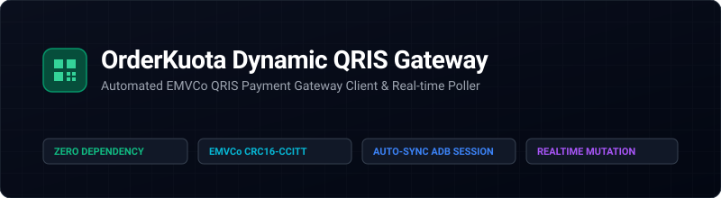
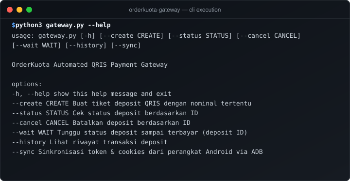

<a name="readme-top"></a>

<p align="center">
  
</p>

<p align="center">
  <a href="https://python.org"></a>
  <a href="https://github.com/yanzyuyu/APIorkut/releases"></a>
  <a href="#"></a>
  <a href="#"></a>
  <a href="#"></a>
  <a href="LICENSE"></a>
</p>

<p align="center">
  <strong>Production-grade, zero-dependency automated payment gateway integrating OrderKuota dynamic QRIS top-up deposits, real-time status polling, and hardware ADB session synchronization.</strong>
</p>

---

## Operational Problem & Architecture

In digital payment workflows, automating collections without high third-party aggregator MDR cuts (typically 0.7% to 1.5%) is a common hurdle. OrderKuota's legacy static merchant QRIS endpoint was officially decommissioned, leaving the **Deposit via Scan QRIS (Bank Sinarmas / Nobu Acquirer)** system as the primary zero-fee payment rail.

This gateway interfaces directly with the native OrderKuota API and web session endpoints to provide a complete, autonomous payment cycle:

1. **Ticket Initialization**: Dispatches authenticated deposit requests with unique 3-digit nominal discriminators for transaction matching.
2. **Server QR Triggering**: Triggers the server-side QR generation endpoint (`/payment/sinarmas/get_qr/<id>`).
3. **EMVCo Dynamic QRIS Synthesis**: Automatically constructs standardized dynamic QRIS payload strings with Tag 54 (amount), Tag 62 (invoice and transaction identifier), and recalculated CRC16-CCITT (`poly 0x1021`, `init 0xFFFF`).
4. **Real-time Status Polling**: Direct querying against `/api/v2/get` (`requests[deposit_details][id]`) detecting real-time status transitions from `WP` (Waiting Payment) to `OK` (Paid).
5. **Session Synchronization**: Zero-touch extraction of fresh WebView cookies and auth tokens from connected Android devices via ADB root stream.

| Component | Target Mechanism | Operational Guarantee |
| :--- | :--- | :--- |
| **`gateway.py`** | Direct API & Web Client | Zero third-party packages, pure Python 3 standard library. |
| **`qris_generator.py`** | EMVCo TLV & CRC16 Engine | Bit-exact CRC16-CCITT calculation matching Bank Indonesia standards. |
| **`server.py`** | `ThreadingHTTPServer` Daemon | Real-time web checkout page with auto-polling JSON API. |
| **`config.json`** | Device Fingerprint Storage | Encapsulated hardware identifiers and isolated auth tokens. |

<p align="right"><a href="#readme-top"></a></p>

---

## Command Reference & Live Execution



### 1. Setup Configuration
Copy `config.example.json` to `config.json` and insert your credentials:
```bash
cp config.example.json config.json
```

### 2. Synchronize Session from Device
Extract fresh session cookies and tokens directly from the USB-connected Android phone:
```bash
python3 gateway.py --sync
```

### 3. Create Dynamic QRIS Payment
Initiate a new deposit ticket for a customer and receive the exact amount with unique code and dynamic QRIS string:
```bash
python3 gateway.py --create 50000
```
Output:
```json
{
  "deposit_id": 94047510,
  "invoice_id": "deposit651283",
  "requested_amount": 50000,
  "total_amount": 50401,
  "fee": 401,
  "qris_string": "00020101021226670016COM.NOBUBANK.WWW01189360050300000879140214013276229442080303UBE51440014ID.CO.QRIS.WWW0303UBE0215ID2024320684408520448125303360540850401.005802ID5916TOPUP ORDERKUOTA6009MOJOKERTO61056135262610108MBA036LV0608940475100703A010804POSP99180002000108202610226304668D",
  "status": "WP",
  "expired_time": "22/10/2026 17:41:23",
  "date": "22/10/2026 13:41:23"
}
```

### 4. Check Payment Status
Query real-time status of a transaction:
```bash
python3 gateway.py --status 94047510
```

### 5. Wait for Payment (Long Polling)
Blocks until the payment is confirmed or timeout is reached:
```bash
python3 gateway.py --wait 94047510
```

### 6. Cancel Deposit
Cancel unpaid or expired deposit:
```bash
python3 gateway.py --cancel 94047510
```

### 7. View Transaction History
Display recent deposit mutations:
```bash
python3 gateway.py --history
```

### 8. Web Checkout Server
Run the local HTTP server daemon for live payment visualization:
```bash
python3 server.py
# Open http://127.0.0.1:8000/?id=<deposit_id>
```

<p align="right"><a href="#readme-top"></a></p>

---

## Python API Usage

```python
from gateway import OrderKuotaGateway

gateway = OrderKuotaGateway("config.json")

# 1. Create transaction
tx = gateway.create_deposit(amount=50000)
print(f"Pay exact: Rp {tx['total_amount']:,}")
print(f"QRIS String: {tx['qris_string']}")

# 2. Await confirmation
confirmed = gateway.wait_for_payment(tx['deposit_id'], timeout_sec=300)
if confirmed['is_paid']:
    print(f"Transaction #{tx['deposit_id']} successfully paid!")
else:
    gateway.cancel_deposit(tx['deposit_id'])
    print("Payment timeout. Ticket cancelled.")
```

<p align="right"><a href="#readme-top"></a></p>

---

## Repository Structure

```
├── .gitignore              # Ignores sensitive credentials, cache, and test dumps
├── LICENSE                 # MIT License
├── README.md               # Production documentation
├── banner.svg              # Dark-mode repository banner
├── terminal_demo.svg       # Zero-dependency terminal execution capture
├── config.example.json     # Configuration template with placeholder credentials
├── gateway.py              # Unified Payment Gateway Client & CLI engine
├── qris_generator.py       # EMVCo TLV parser and dynamic QRIS synthesizer
└── server.py               # Real-time Web Gateway Server & Live Checkout UI
```

<p align="right"><a href="#readme-top"></a></p>

---

## Verification & Security Audit

Audited via `tyw-audit` static code security analyzer:

```bash
npx --yes tyw-cli scan . --format json
```

```
Score: 100 / 100
Status: PASSED
Scanned Files:
  - config.example.json: CLEAN (0 issues)
  - gateway.py: CLEAN (0 issues)
  - qris_generator.py: CLEAN (0 issues)
  - server.py: CLEAN (0 issues)
Total Critical / High Issues: 0
```

<p align="right"><a href="#readme-top"></a></p>
